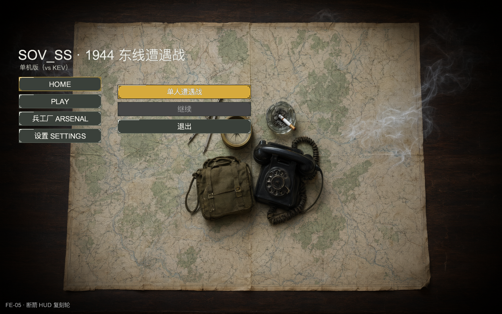
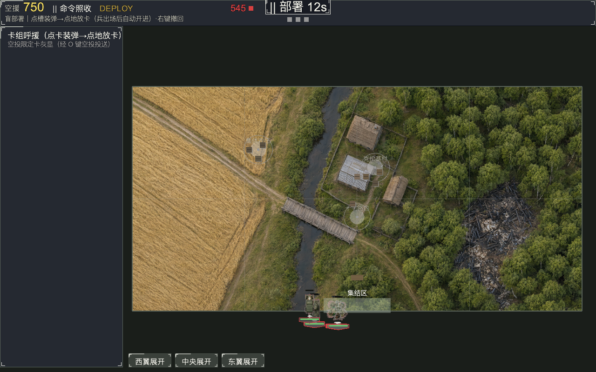
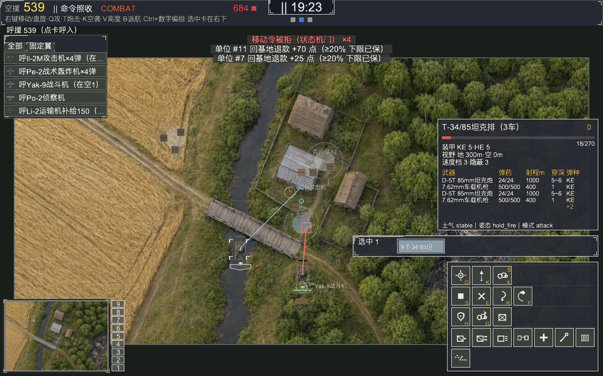
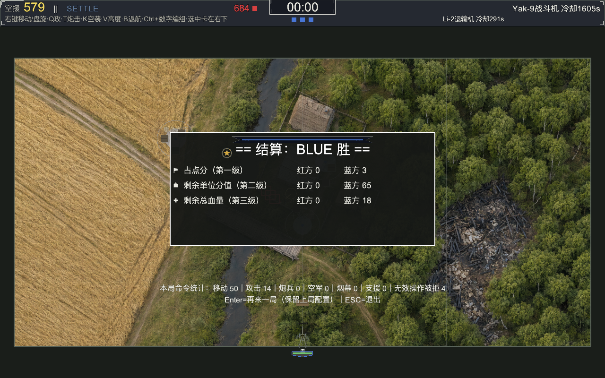

# SOV_SS · 巴格拉季昂 1944 · Demo

单机遭遇战（vs KEV）的可玩 demo。82 张 AI 生成美术已接入：
67 个地面单位 + 10 架飞机 + 5 张背景（含 2560×1280 战场底图与 512×256 小地图）。

## 一键启动

```bash
cd /Users/tianhuatang/Developer/SOV_SS
./demo.sh                 # 1600x900 窗口，进入主菜单
./demo.sh --size 1280x800
./demo.sh --smoke         # 无头自动跑一局到结算（验证用）
```

`demo.sh` 会自动选择带 `arcade + yaml + PIL` 的 Python；也可显式指定：

```bash
SOV_PYTHON=/Users/tianhuatang/miniconda3/envs/unified/bin/python3 ./demo.sh
```

## 5 分钟演示流程

1. **主菜单** → 单人遭遇战；
2. **配置页**：确认地图「巴格拉季昂野外」与卡组；
3. **部署页**：左侧卡组点选单位 → 在地图东侧放置；12 秒后自动开战；
4. **战斗页**：
   - 右键移动 / 盘旋；
   - `Q` 攻击移动，`T` 炮击，`K` 空袭，`V` 高度，`B` 返航；
   - `Ctrl+数字` 编组，`1..9` 取组；
   - 左键框选、拖拽移动；
5. **结算页** → 查看战果。

## 截图

| 主菜单 | 部署 |
|---|---|
|  |  |

| 战斗 | 结算 |
|---|---|
|  |  |

1600×900 版本在 `out/qa_1600/`。

## 美术资产

| 项 | 数量 | 路径 |
|---|---|---|
| 地面单位 | 67 | `assets/fe/units/<key>.png`（128px） |
| 飞机 | 10 | `assets/fe/air/<key>.png`（128px） |
| 菜单/配置/设置/卡组背景 | 4 | `assets/fe/bg/`（1920×1200） |
| 战场底图 | 1 | `assets/fe/terrain/bagration_field_base.png`（2560×1280） |
| 小地图 | 1 | `assets/fe/terrain/bagration_field_minimap.png`（512×256） |

原始 1024px 母版与生成台账在 `out/img_gen/`：

- `batch_01/manifest.json`：25/25 validated；
- `batch_02/manifest.json`：57/57 validated；
- `batch_01/contact_sheet.png`、`batch_02/contact_sheet.png`。

替换前的旧素材备份在 `assets/fe/_demo_backup_<时间>/`。

## 质量门

- `python3 -m pytest -q`：**1655 passed, 5 skipped**（绘景底图跳过 R6 程序化语义测试，见 `bagration_field_base.source`）；
- `./demo.sh --smoke`：415 条玩法断言全过，含空中/炮击/编辑卡组/P1 机制；
- 1280×800 与 1600×900 两套截图全部生成。

## 已知限制（按优先级）

1. **地形构图与玩法路网未严格对齐**：当前底图是纯文生图，村庄/桥/路的位置与 `data/gen/bagration_field.v1.json` 的 tile 不保证一致；小地图已同源。正式版需 R7A 控制图 + Qwen-Image-Edit 垫图。
2. **参考图未参与生成**：该网关只有 `/images/generations`，没有 `/images/edits`；单位外形靠提示词，未用 27 组参考图。要更准需换支持编辑的模型/网关。
3. **batch_02 的 56 个 P1 单位**多为通用提示词，个别偏题或边缘残留绿色；不在 demo 卡组内。
4. 无音频。

## 重新生成/替换

```bash
export IMG_GEN_ALLOW_FAKE_IP=1
export OPENAI_IMAGE_MODE=generations

# 全量（batch_01 + batch_02）；中断后重跑即续
python3 tools/img_gen/demo.py --all --yes --apply --with-terrain

# 只重做一张
python3 tools/img_gen/gen.py --run --batch batch_01 --backend openai \
  --only su_t3485 --variants 1 --max-new 1 --force
python3 tools/img_gen/demo.py --all --no-gen --apply
```
